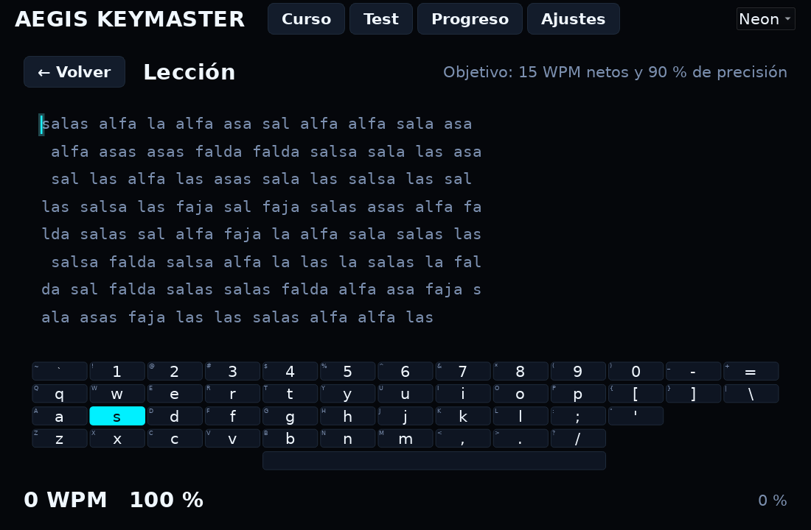
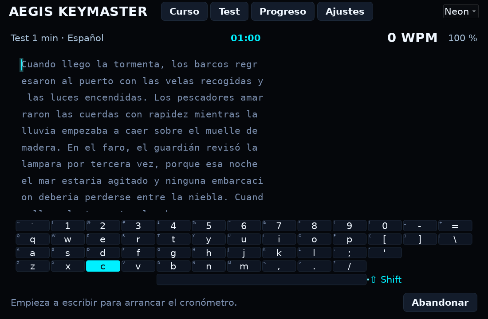
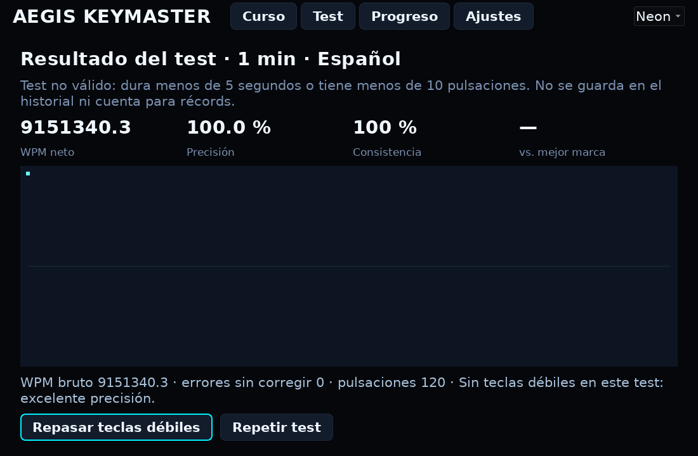
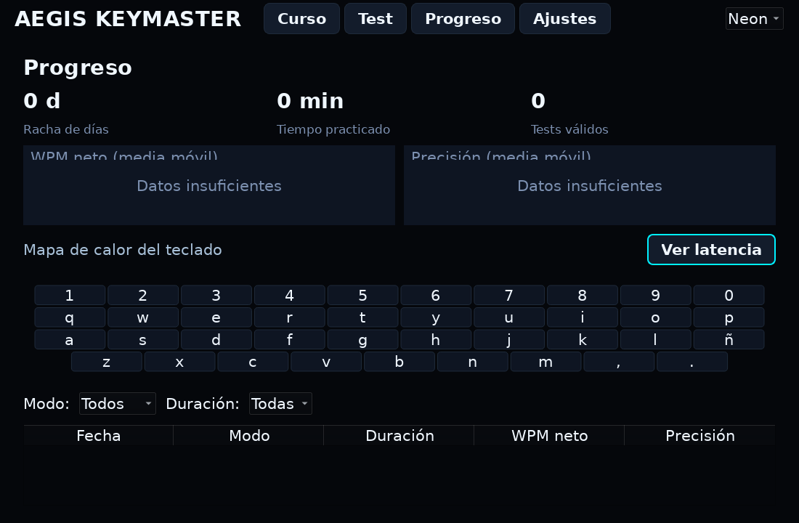

# Aegis Keymaster



**Touch-typing tutor for Linux with a cyberpunk neon interface.**
Built with PySide6 · 100% offline · No telemetry · Spanish and English UI.

Aegis Keymaster teaches touch typing from zero, measures you with timed tests,
shows which keys you miss and why, and tracks your progress for weeks — with a
disciplined neon aesthetic where the glow lives only where it matters: the
typing zone, the cursor and the active key.

## Screenshots

| Course | Timed test |
| --- | --- |
|  |  |

| Test report | Progress |
| --- | --- |
|  |  |

## Features

- **Structured course** — 15 progressive lessons: home row, top row, bottom row,
  capitals, numbers, symbols, and Spanish accents (`á é í ó ú ü ñ ¿ ¡`).
  Stars per lesson, unlock chain, pass criteria from 15 WPM / 90% up to
  35 WPM / 95%.
- **Timed tests** — 1, 3 or 5 minutes, countdown, live WPM, full report:
  net/gross WPM, accuracy, consistency, 5-second speed chart, uncorrected
  errors, weak keys of the test and comparison with your best mark. Invalid
  tests (under 5 s or 10 keystrokes) never enter the history.
- **Weak keys** — error rate and average latency per key, heatmap on the
  virtual keyboard, one-click review drills (reviews never affect lesson passes).
- **Virtual keyboard** — drawn from the active layout data (never hardcoded):
  highlights the next key, required Shift/AltGr, dead keys and your weak keys
  in amber. Can be hidden.
- **Layouts as data** — `us`, `latam` and `es` with dead keys and AltGr,
  autodetected via `setxkbmap`/`localectl`. Dead-key composition (´ + a → á)
  counts the composed character, not the dead press.
- **Progress panel** — WPM and accuracy trends, best marks per duration,
  practice time, day streak, keyboard heatmap, filterable history, CSV/JSON export.
- **Profiles and persistence** — multiple local profiles under
  `~/.local/share/aegis-keymaster/`, atomic writes with automatic `.bak`
  backups, schema migrations and recovery from corrupted files.
- **Sound** — key click, error, lesson pass and test end, synthesized in code
  and played with QSoundEffect; volume, mute and full disable. Degrades
  silently when no audio backend is available.
- **Three themes** — Neon, Dark and Light, all audited against WCAG AA
  (4.5:1 text contrast) with the script in `scripts/check_contrast.py`.
- **First run onboarding** — maximum 3 screens: language and layout, a 1-minute
  placement test, and a course entry point recommendation. Always skippable.

## Installation

One command (user install, no root):

```bash
./install.sh
```

Then launch it from the menu (**Aegis Keymaster**) or run:

```bash
aegis-keymaster
```

To uninstall (keeps your user data):

```bash
./install.sh --uninstall
```

Manual install with pip also works:

```bash
pip install --user .
```

### Requirements

- Linux (tested on Lubuntu 26.04, LXQt; X11 and Wayland)
- Python 3.10+
- PySide6 6.8.3 (pinned in `requirements.txt`)

### Run from source

```bash
pip install -r requirements.txt
python -m src.main
```

## Keyboard shortcuts

| Shortcut | Action |
| --- | --- |
| type | answer the lesson / test text |
| Backspace | correct the previous character |
| Esc | abandon the current test or lesson review |
| Tab / arrow keys | move between controls outside the typing zone |
| Enter | activate the focused button |

## Project structure

```
Aegis_Keymaster/
├── src/
│   ├── main.py, app.py          # entry point, application lifecycle
│   ├── __version__.py           # single source of the version
│   ├── core/                    # pure logic, no Qt imports
│   │   ├── typing_test.py       # timed test engine (injectable clock)
│   │   ├── engine.py            # typing engine (WPM, accuracy, states)
│   │   ├── lessons.py           # course, unlocks, stars
│   │   ├── layouts.py           # layout data model + dead keys + AltGr
│   │   ├── weak_keys.py         # error and latency tracking per key
│   │   ├── persistence.py       # profiles, atomic writes, migrations
│   │   ├── stats.py, export.py  # aggregates, CSV/JSON export
│   │   ├── sound.py             # WAV synthesis
│   │   └── i18n.py              # es/en strings
│   ├── ui/                      # windows, widgets, themes (PySide6)
│   │   ├── main_window.py, typing_area.py, virtual_keyboard.py
│   │   ├── course_mode.py, test_mode.py, progress_screen.py
│   │   ├── settings_screen.py, onboarding.py
│   │   ├── themes.py, fonts.py, effects.py, sound_player.py
│   │   └── contrast.py          # WCAG AA audit helpers
│   ├── data/                    # lessons, layouts, word lists (JSON)
│   ├── assets/fonts/            # DejaVu fonts (free license, bundled)
│   └── utils/
├── assets/icons/                # generated from Logo.png (16–256 px)
├── packaging/                   # .desktop entry
├── docs/                        # design plan, audit, performance, screenshots
├── scripts/                     # capture, benchmark, contrast, generators
├── tests/                       # core + offscreen UI tests
├── legacy/                      # archived CustomTkinter modules
└── install.sh
```

## Performance budgets (measured, offscreen)

| Budget | Target | Measured |
| --- | --- | --- |
| Boot to usable window | < 2 s | ~9 ms |
| Keystroke → repaint (p95) | < 16 ms | ~2 ms |
| Effects | 60 fps at High, auto-downgrade under 45 fps | implemented |
| RAM | < 250 MB | ~70 MB |

Details and methodology: `docs/performance.md`.

## Development

```bash
pip install -r requirements.txt
pip install pytest pytest-cov ruff
python -m pytest                 # core + offscreen UI tests
ruff check src/ scripts/ tests/  # lint
python scripts/check_contrast.py # WCAG AA audit
QT_QPA_PLATFORM=offscreen python scripts/benchmark.py
QT_QPA_PLATFORM=offscreen python scripts/capture_screens.py
```

Architecture rule: `src/core` contains pure logic and never imports Qt; the UI
talks to core through signals and data objects.

## Status

See [STATE.md](STATE.md) for phase-by-phase status and
[CHANGELOG.md](CHANGELOG.md) for the change log.

---

*Aegis Keymaster — type with precision, glow with style.*
